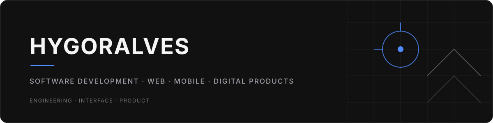

### Hygor Gabriel Alves Montenegro

**Desenvolvedor de Software | Front-end & Mobile**

Desenvolvo aplicações, sistemas e produtos digitais conectando engenharia de software, experiência do usuário e visão de produto.

---

## Beyond the Interface

### Software is more than what users see.

Software vai além do que aparece na tela. Construir uma solução envolve conectar interfaces a regras de negócio, dados, integrações e decisões de arquitetura e produto. No meu trabalho, busco equilibrar esses elementos com usabilidade e organização técnica, da aplicação visível aos sistemas e ferramentas que a sustentam.

---

## Engineering Scope

Áreas que se complementam na construção e evolução de software:

- **Front-end Engineering** — interfaces responsivas, componentização e organização visual de aplicações.
- **Mobile Engineering** — aplicações multiplataforma, interfaces móveis e reutilização de componentes e lógica quando apropriado.
- **Back-end & Integrations** — APIs, regras de negócio e comunicação entre aplicações e serviços.
- **Data & Persistence** — organização e modelagem de dados relacionais e não relacionais.
- **Systems & Digital Products** — sistemas administrativos, plataformas web, produtos SaaS e ferramentas reutilizáveis.
- **Interface & Product Design** — consistência visual, usabilidade, responsividade e estruturação de experiências digitais.
- **Development Tools & Infrastructure** — versionamento e organização de ambientes de desenvolvimento.

---

## Technology Stack

### Front-end

  
  
  
  
  
  
  

### Mobile

  
  

### Back-end & Data

  
  
  

APIs e integrações

### Ferramentas

  
  
  

**Design & experiência do usuário:** design de interfaces, responsividade, usabilidade e organização de sistemas de design.

---

## Selected Products

### Different challenges. Connected by technology.

Produtos digitais de diferentes áreas. As descrições abaixo apresentam o propósito dos produtos; detalhes sobre minha contribuição técnica e implementação devem ser acrescentados somente quando confirmados e autorizados para divulgação.

### Velyon Robotics

**HealthTech · Fisioterapia · Robótica**

Uma plataforma que une ciência, fisioterapia e robótica, aproximando tecnologia e reabilitação.

[Site oficial](https://velyonrobotics.com/)

<!-- Para complementar este case, confirme sua contribuição técnica, tecnologias, imagens reais, repositório público ou demonstração/documentação adicional. -->

### ONiGO

**Streaming · Entretenimento digital**

Uma plataforma de streaming dedicada à experiência de entretenimento e ao consumo de conteúdo digital.

[Site oficial](https://onigo.com.br/)

<!-- Para complementar este case, confirme sua participação técnica, tecnologias, imagens reais e links públicos adicionais. -->

### Ecossistema CYON

**Conectividade · Tecnologia · Segurança**

Conectividade, tecnologia e segurança integradas em um ecossistema digital. Entre as frentes relacionadas estão **CYON Digital**, **CYON Fibra** e **CYON Móvel**.

<!-- Adicione links oficiais das verticais somente após confirmar os endereços. Para detalhar o case, confirme contribuição, tecnologias e materiais que podem ser divulgados. -->

### LixoCerto

**Sustainability Tech · Sustentabilidade · Impacto social**

Descubra como separar seu lixo, encontre pontos de coleta e transforme bons hábitos em conquistas. Uma plataforma digital voltada à conscientização ambiental e à adoção de hábitos sustentáveis, aproximando tecnologia, sustentabilidade e participação dos usuários.

[Site oficial](https://centrallixocerto.com.br/)

<!-- Para complementar este case, confirme sua contribuição técnica, tecnologias e funcionalidades que podem ser divulgadas. -->

### CYON Live

**Streaming · Canais ao vivo**

Uma plataforma digital dedicada à experiência de canais ao vivo, associada ao universo de soluções digitais da CYON.

<!-- Adicione o link oficial após confirmar o endereço. Para complementar este case, confirme contribuição técnica, tecnologias, imagens reais e demonstração pública. -->

---

## What's Next

Novos produtos, novos desafios e novas possibilidades. Este portfólio continuará evoluindo à medida que novos projetos forem desenvolvidos e puderem ser apresentados publicamente.

---

## Professional Experience

### Onitelecom

**Desenvolvedor Front-end e Mobile** · junho de 2024 — atual

Atuação no desenvolvimento de aplicações web e mobile, implementação de interfaces, criação de funcionalidades e evolução de produtos digitais.

### Formação

**Ciência da Computação** · UNIPÊ

Em fase de conclusão.

---

## GitHub Analytics

Estatísticas carregadas dinamicamente para `hg0407`. Os cards são recursos externos; o restante do perfil permanece disponível caso o serviço não carregue.

  

  

---

## Let's Build Something Meaningful

Estou aberto a conversas sobre desenvolvimento de software, produtos digitais, oportunidades profissionais e projetos que possam transformar ideias em soluções funcionais.

- [GitHub](https://github.com/hg0407)
- [LinkedIn](https://www.linkedin.com/in/hygoralves/)

<!-- Opcional: adicione seu e-mail profissional como link mailto:. -->
<!-- Opcional: adicione seu WhatsApp com um link público que queira divulgar. -->

**HYGORALVES**

