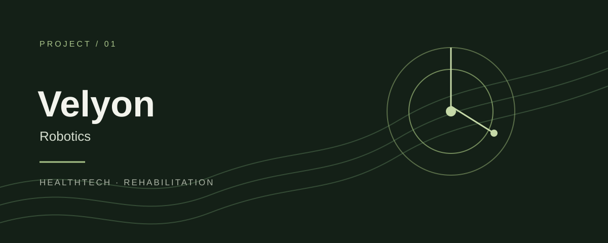
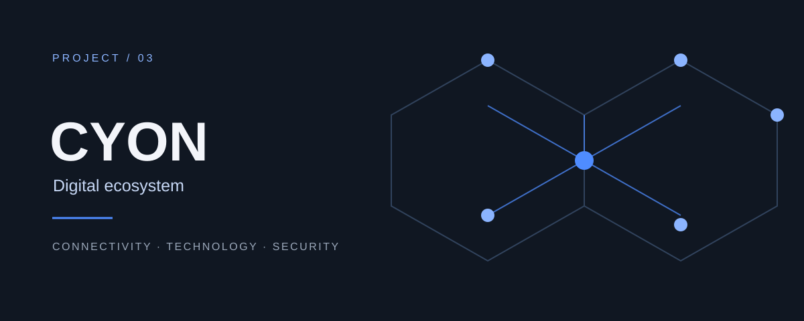
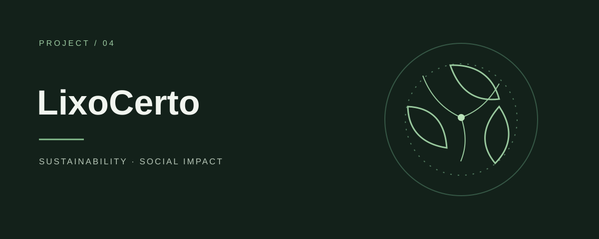
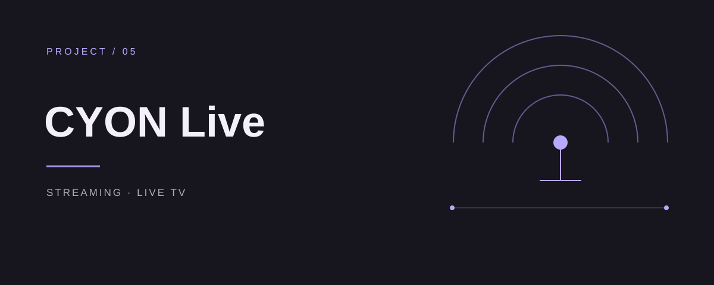
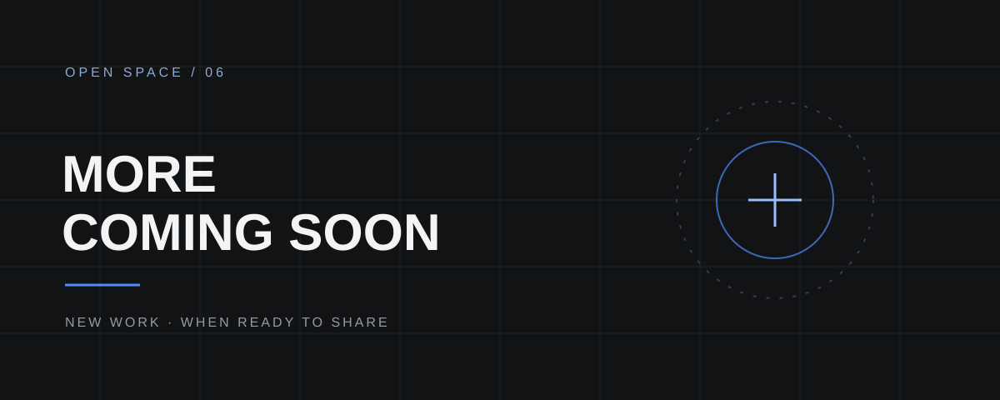

**Desenvolvedor de Software · Front-end & Mobile**

Construindo aplicações, sistemas e produtos digitais.

[GitHub](https://github.com/hg0407) · [LinkedIn](https://www.linkedin.com/in/hygoralves/)

---

## ABOUT

Desenvolvedor de software com foco em interfaces, produtos digitais e sistemas funcionais. Trabalhando entre front-end, mobile, integrações e organização de experiências de uso, busco combinar código, design e clareza de produto.

Atualmente na **Cyon Systems**, desenvolvendo aplicações web e mobile, e concluindo **Ciência da Computação** no **UNIPÊ**.

---

## STACK

**FRONT-END**

  
  
  
  
  
  
  
  

**MOBILE**

  
  

**BACK-END**

  

APIs

**BANCO DE DADOS**

  
  

**FERRAMENTAS E INFRAESTRUTURA**

  
  
  

---

## SELECTED WORK

### Digital products across different industries.

Capas gráficas autorais para apresentação dos produtos — não são capturas de tela nem logotipos oficiais.

<table>
  <tr>
    <td width="50%" valign="top">
      
      <h3>Velyon Robotics</h3>
      HEALTHTECH · ROBOTICS
      
Plataforma de fisioterapia que une ciência e robótica.

      <a href="https://velyonrobotics.com/">Site oficial ↗</a>
    </td>
    <td width="50%" valign="top">
      
      <h3>ONiGO</h3>
      STREAMING · ENTERTAINMENT
      
Plataforma de streaming e entretenimento digital.

      <a href="https://onigo.com.br/">Site oficial ↗</a>
    </td>
  </tr>
  <tr>
    <td width="50%" valign="top">
      
      <h3>CYON Digital</h3>
      CONNECTIVITY · TECHNOLOGY · SECURITY
      
Ecossistema de conectividade, tecnologia e segurança, com frentes relacionadas como CYON Fibra e CYON Móvel.

    </td>
    <td width="50%" valign="top">
      
      <h3>LixoCerto</h3>
      SUSTAINABILITY · SOCIAL IMPACT
      
Plataforma para separar resíduos, encontrar pontos de coleta e incentivar hábitos sustentáveis.

      <a href="https://centrallixocerto.com.br/">Site oficial ↗</a>
    </td>
  </tr>
  <tr>
    <td width="50%" valign="top">
      
      <h3>CYON Live</h3>
      STREAMING · LIVE TV
      
Plataforma digital de canais ao vivo.

    </td>
    <td width="50%" valign="top">
      
      <h3>MORE COMING SOON</h3>
      EM EVOLUÇÃO
      
Novos produtos serão apresentados quando puderem ser divulgados.

    </td>
  </tr>
</table>

---

## GitHub Analytics

Os endpoints do GitHub Readme Stats retornaram `503` na validação. Para uma leitura mais fiel ao meu uso real de código, usei o gráfico de linguagens por commits, que costuma representar melhor a rotina de desenvolvimento.

---

## EXPERIENCE

**CYON SYSTEMS** · Desenvolvedor Front-end & Mobile · Jun 2024 — Atual 
**UNIPÊ** · Ciência da Computação · Em fase de conclusão

---

## CONTACT

[GitHub](https://github.com/hg0407) · [LinkedIn](https://www.linkedin.com/in/hygoralves/)

HYGORALVES · SOFTWARE & DIGITAL PRODUCTS

